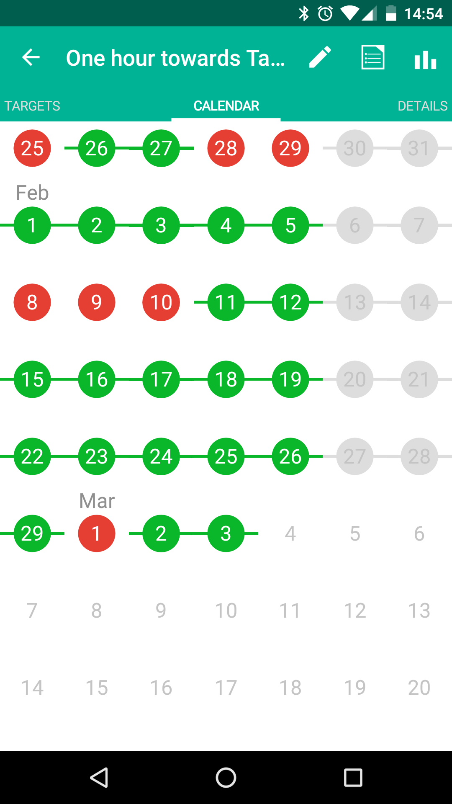

It's been almost a year since I decided to build a new call recording tool 
for documentary radio journalists. For the first ten months or so progress was slow. 
I've found myself caught up in consulting work and weeks would go by when I
didn't look at the project. But during the last two months I've been able to
carve out more time and things are starting
to happen.

I've been employing the old jedi mind trick of dedicating at least an hour a
day towards my project. That has kept Tapesync at the top of my mind and on most
days the hour has extended to the entire day. I'm using a habit shaping app 
called Rewire to help me stay on track.

{: .post_image}

Tapesync will have a desktop and a mobile client and I've been making headway
with the desktop client. I'm now at a point where I can place and record calls
from the desktop client to a PSTN endpoint (aka a "phone"). I have the basic 
telephony server set up.
