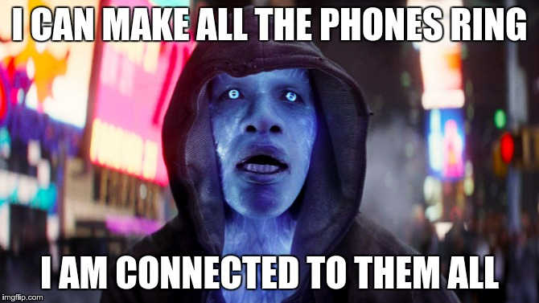

It's been almost a year since I decided to build a new call recording tool 
for documentary radio journalists. For the first ten months or so progress was
slow. I got stuck with consulting work and weeks would go by when I didn't
look at Tapesync. But during the last two months I've been able to
carve out more time and things are beginning to happen.

I've been employing an old jedi mind trick of dedicating at least an hour a
day towards my project. That has kept Tapesync at the top of my mind and on most
days the hour has been stretched out, often to the entire day. 

Tapesync will have a desktop and a mobile client and I've been making headway
with the desktop client. I'm now at a point where I can place calls
from the desktop client to a PSTN endpoint (aka a "phone"), record the call at
the local end in 44kHz and capture the remote end of the conversation at the 
server in 8kHz. 

The technology choice for the desktop client fell on
[Electron](http://electron.atom.io/) and so far that's been a pleasant 
experience. For the telephony server I went with 
[FreeSwitch](https://freeswitch.org/) and I'll probably have to put 
[Kamailio](https://www.kamailio.org/w/) in front of that. The telephony stuff is
just plain hard. There's no way around that. But when it works it's
exhilarating.

*Me programming telephony servers*

Anyway, tons of stuff remains to be coded, problems solved, technologies
learned. Stay tuned!
