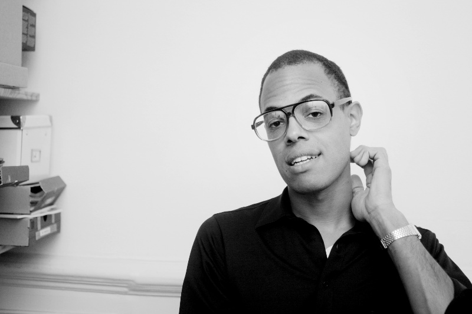

*Photo by Sannah Kvist*

My name is Oivvio Polite. I'm an independent software developer based in
Stockholm/Sweden. Before going into tech I worked fifteen years as a freelance 
journalist. Mostly I was doing print but I dabbled a bit in radio and when
doing so I got very frustrated with the digital tools available for doing
documentary radio. It's clear that there's a lack of tools built for
documentary radio journalism. This goes for audio editing,  where we work mostly
with tools made for musicians, as well as remote recording, where
existing solutions cater to people doing live news or studio discussions. Now,
with Tapesync, I'm doing something about that. I'm building a call recording
solution catering specifically to the documentary radio journalist. It is going
to be awesome.

